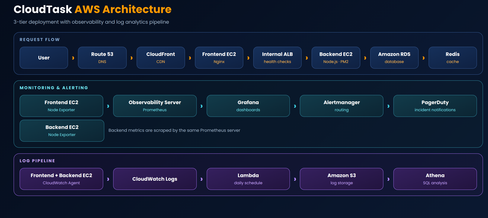
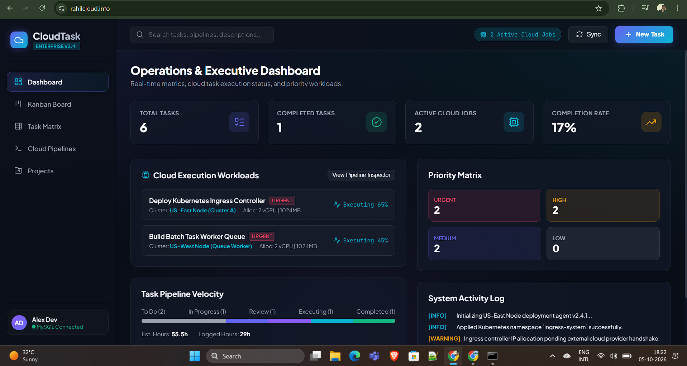
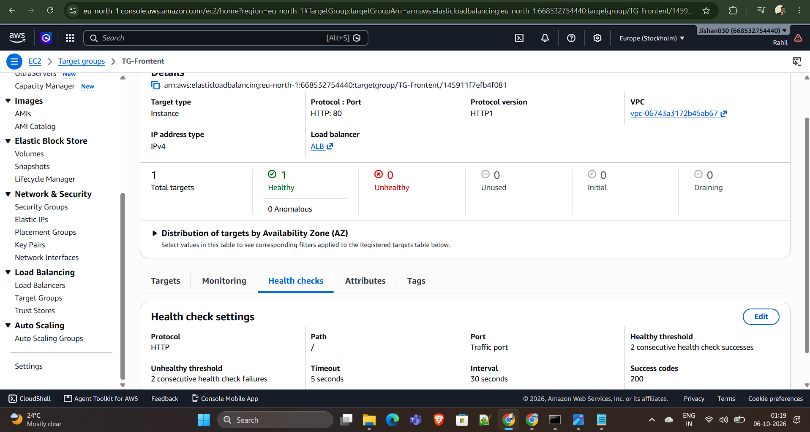
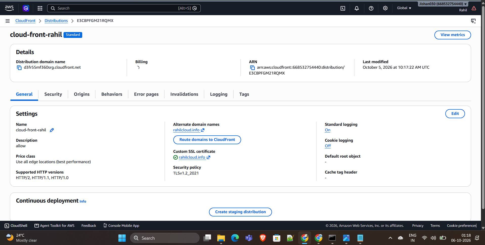
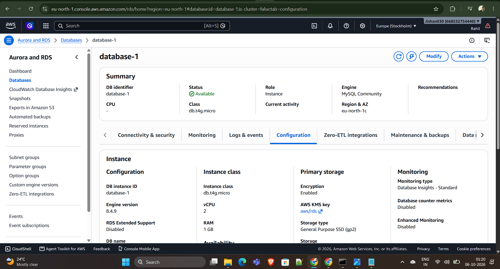
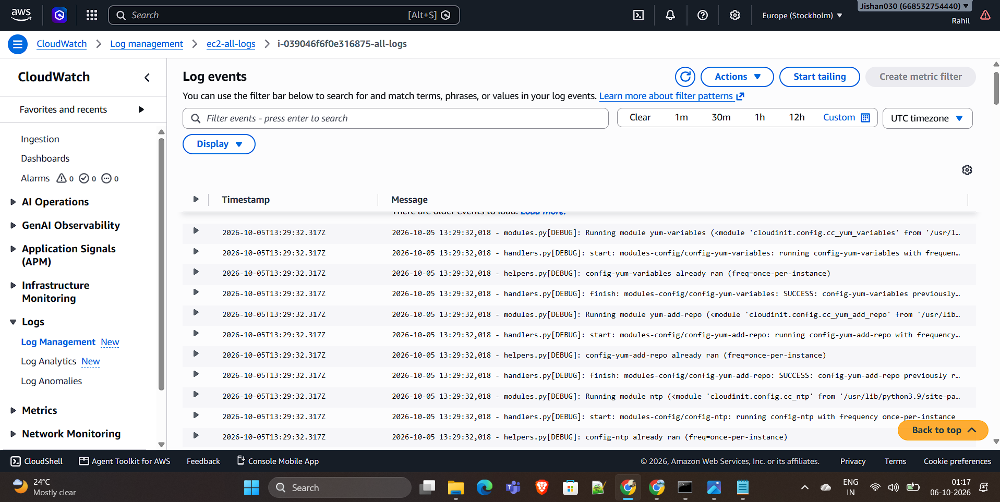
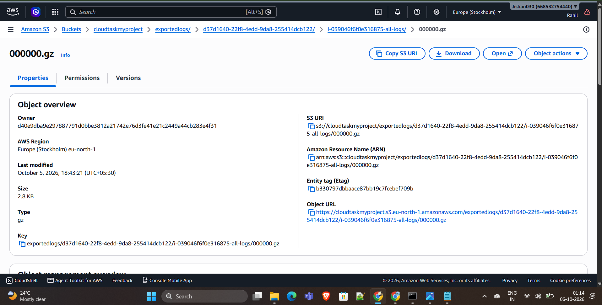

# CloudTask — AWS 3-Tier Cloud Infrastructure


CloudTask is an AWS-based 3-tier application environment designed and deployed to demonstrate practical \*\*Cloud Engineering, Infrastructure Engineering, AWS Networking, Security, Load Balancing, Observability, and Serverless Automation\*\*.


The primary focus of this project is the \*\*cloud infrastructure and architecture\*\*, rather than application development.


\---


## Cloud Architecture


```text

                              Internet

                                  |

                                  v

                           Amazon Route 53

                                  |

                                  v

                            CloudFront

                                  |

                                  v

                     Internet-facing ALB

                                  |

                                  v

                         Frontend EC2

                            + Nginx

                                  |

                                  v

                         Internal ALB

                                  |

                                  v

                          Backend EC2

                                  |

                                  v

                         Amazon RDS

                            MySQL

```


### Centralized Logging & Automation


```text

              Frontend EC2        Backend EC2

                   |                   |

                   +---------+---------+

                             |

                             v

                    CloudWatch Agent

                             |

                             v

                     CloudWatch Logs

                       ec2-all-logs

                             |

                             v

                    Lambda: Daily-log

                             |

                             v

                         Amazon S3

                             |

                             v

                       Amazon Athena

```


\---


## Project Objective


The objective of this project was to design and implement a cloud infrastructure environment that demonstrates:


\* Multi-tier AWS architecture

\* Network segmentation

\* Public and internal load balancing

\* Secure backend communication

\* Managed database integration

\* CDN-based application delivery

\* IAM-based access control

\* Secrets management

\* Centralized logging

\* Serverless log archival

\* S3-based log storage

\* Athena-based log analysis

\* Secure EC2 administration


\---


# AWS Infrastructure


## Compute


### Amazon EC2


EC2 instances are used for the application tiers.


The infrastructure separates the frontend and backend workloads to establish clear application boundaries and controlled network communication.


Key responsibilities include:


\* Server provisioning

\* Application deployment

\* Nginx configuration

\* Backend process management

\* CloudWatch Agent configuration

\* Server troubleshooting

\* System administration


\---


# Networking


## Amazon VPC


The environment uses Amazon VPC to provide network isolation and control communication between infrastructure components.


The architecture uses:


\* VPC

\* Subnets

\* Internet Gateway

\* Route Tables

\* Security Groups

\* Network ACLs

\* Load Balancers


The infrastructure is designed so that internal application components are not unnecessarily exposed to the public internet.


\---


## Network Security


### Security Groups


Security Groups are used to control traffic between infrastructure layers.


The architecture follows a tier-based communication model:


```text

Internet

   |

   v

Public ALB

   |

   v

Frontend

   |

   v

Internal ALB

   |

   v

Backend

   |

   v

RDS

```


Only required communication paths are allowed between the different layers.


### Network ACLs


Network ACLs provide an additional subnet-level network control layer.


They are used alongside Security Groups rather than as a replacement for them.


\---


# Load Balancing


## Application Load Balancer


Application Load Balancers are used to control and distribute application traffic.


The deployment uses:


### Internet-facing ALB


Handles traffic reaching the frontend tier.


### Internal ALB


Provides private communication between the frontend and backend tiers.


```text

Client

  |

  v

Internet ALB

  |

  v

Frontend EC2

  |

  v

Internal ALB

  |

  v

Backend EC2

```


This design avoids exposing the backend service directly to external traffic.


\---


# Content Delivery


## Amazon CloudFront


CloudFront is used as the content delivery layer in front of the application.


Responsibilities include:


\* CDN-based content delivery

\* HTTPS delivery

\* Edge-based content distribution

\* Integration with the application entry point


Traffic flow:


```text

User

 |

 v

CloudFront

 |

 v

Application Entry Point

```


\---


# DNS


## Amazon Route 53


Route 53 is used for DNS management and domain routing.


The DNS layer provides the entry point for the application architecture and integrates with the AWS traffic flow.


```text

Domain

  |

  v

Route 53

  |

  v

CloudFront

  |

  v

AWS Application Infrastructure

```


\---


# Database Infrastructure


## Amazon RDS for MySQL


Amazon RDS provides the managed relational database layer.


The backend communicates with RDS through the AWS network.


Infrastructure responsibilities include:


\* Database connectivity

\* Network access control

\* Backup and recovery configuration

\* Managed database operations

\* Secure application-to-database communication


The application credentials are not stored in this repository.


\---


# Secrets Management


## AWS Secrets Manager


AWS Secrets Manager is used for secure application secret management.


The backend supports retrieving database configuration from Secrets Manager instead of storing credentials directly in source code.


Example environment configuration:


```text

AWS\_REGION=

AWS\_SECRET\_NAME=

USE\_AWS\_SECRET\_MANAGER=

```


Actual secret values are intentionally excluded from the repository.


\---


# IAM & Least Privilege


AWS IAM is used to provide controlled permissions to AWS services.


The project avoids embedding AWS access keys or secret credentials inside application code.


The Lambda log archival workflow uses an IAM execution policy containing permissions required for:


\* CloudWatch Logs export

\* CloudWatch Logs metadata access

\* S3 bucket access

\* S3 object creation


Policy:


```text

iam/lambda-daily-log-policy.json

```


\---


# Centralized Logging


Centralized EC2 logging is implemented using the Amazon CloudWatch Agent.


Both frontend and backend server logs are collected into CloudWatch Logs.


### Logging Architecture


```text

Frontend EC2 ─────┐

                  |

                  v

          CloudWatch Agent

                  |

                  v

           CloudWatch Logs

            ec2-all-logs

                  ^

                  |

Backend EC2 ──────┘

```


This provides a centralized location for infrastructure and application logs.


\---


# Serverless Log Archival


## AWS Lambda — Daily-log


A Python-based Lambda function automates the CloudWatch Logs archival workflow.


Function:


```text

Daily-log

```


Source:


```text

lambda/lambda\_function.py

```


The function creates a CloudWatch Logs export task for the previous complete UTC day.


### Workflow


```text

CloudWatch Logs

      |

      v

Lambda

      |

      v

Amazon S3

```


Logs are organized using date-based prefixes:


```text

cloudwatch-logs/YYYY/MM/DD

```


The Lambda function uses its execution role for AWS authentication and does not contain hardcoded credentials.


\---


# Amazon S3


Amazon S3 is used as the centralized destination for archived CloudWatch Logs.


The storage workflow provides:


\* Centralized log archival

\* Date-based organization

\* Durable object storage

\* Separation between active CloudWatch Logs and archived data

\* Data source for further analysis


\---


# Amazon Athena


Amazon Athena provides the SQL analysis layer for archived log data.


The repository contains:


```text

athena/queries.sql

```


The intended workflow is:


```text

CloudWatch Logs

      |

      v

S3 Archive

      |

      v

Athena

      |

      v

SQL-based Analysis

```


The Athena table schema is based on the actual exported CloudWatch Logs object format rather than assuming a fixed log structure.


\---


# AWS Systems Manager


AWS Systems Manager is used for secure EC2 administration.


The infrastructure uses SSM-based access for server management and troubleshooting without requiring direct public SSH exposure.


Typical operational tasks include:


\* Server access

\* Service troubleshooting

\* Configuration validation

\* Log inspection

\* Application process management

\* Infrastructure diagnostics


\---


# Nginx


Nginx is used as the frontend web server and reverse proxy.


Responsibilities include:


\* Serving the frontend

\* SPA routing

\* `/api` request forwarding

\* Reverse proxy configuration

\* Communication with the internal backend load balancer


Configuration files:


```text

nginx/

├── nginx.conf

└── google-store.conf

```


Nginx is treated as part of the infrastructure/deployment layer rather than the application-development focus of this project.


\---


# Backend Process Management


The backend process configuration is maintained through PM2.


Configuration:


```text

scripts/ecosystem.config.js

```


The configuration defines:


\* Application process

\* Working directory

\* Node.js interpreter

\* Restart behavior

\* Process execution mode

\* Memory restart threshold


\---


# Infrastructure Configuration Repository


This repository keeps infrastructure-related configuration alongside the application workload.


```text

cloudtask-aws-3tier-deployment/

│

├── backend/

├── frontend/

├── database/

│

├── nginx/

│   ├── nginx.conf

│   └── google-store.conf

│

├── cloudwatch/

│   └── amazon-cloudwatch-agent.json

│

├── lambda/

│   └── lambda\_function.py

│

├── iam/

│   └── lambda-daily-log-policy.json

│

├── athena/

│   └── queries.sql

│

├── scripts/

│   └── ecosystem.config.js

│

├── docs/

│   └── screenshots/

│

└── .gitignore

```


\---


# Deployment Flow


```text

1\. AWS VPC & Networking

          ↓

2\. EC2 Infrastructure

          ↓

3\. Security Groups / NACLs

          ↓

4\. Load Balancers

          ↓

5\. Frontend Infrastructure

          ↓

6\. Internal Backend Routing

          ↓

7\. RDS Integration

          ↓

8\. Route 53

          ↓

9\. CloudFront

          ↓

10\. CloudWatch Logging

          ↓

11\. Lambda Automation

          ↓

12\. S3 Log Archive

          ↓

13\. Athena Analysis

```


\---


# Security Architecture


The infrastructure follows multiple layers of security controls:


```text

                    Internet

                       |

                 CloudFront

                       |

                Public ALB

                       |

                Frontend Tier

                       |

               Internal ALB

                       |

                Backend Tier

                       |

                  RDS Tier

```


Security controls include:


\* IAM roles

\* Security Groups

\* Network ACLs

\* Internal Load Balancer

\* AWS Secrets Manager

\* Systems Manager

\* CloudWatch logging

\* HTTPS delivery through CloudFront

\* No hardcoded AWS credentials

\* No committed `.env` files


\---


# Monitoring & Operations


CloudWatch is used for centralized logging and infrastructure visibility.


The project also demonstrates operational practices such as:


\* EC2 log collection

\* Centralized log management

\* Server troubleshooting

\* Service configuration

\* Process management

\* AWS Systems Manager access

\* Log archival

\* SQL-based log analysis


\---


# Key Cloud Engineering Highlights


\* Designed a \*\*3-tier AWS cloud architecture\*\* with separated application layers.

\* Implemented \*\*public and internal Application Load Balancers\*\*.

\* Configured controlled communication between frontend, backend, and database tiers.

\* Implemented \*\*VPC-level and subnet-level network controls\*\*.

\* Integrated Amazon RDS as the managed database layer.

\* Implemented \*\*Secrets Manager-based secret retrieval\*\*.

\* Configured CloudFront and Route 53 as application delivery and DNS layers.

\* Implemented centralized EC2 logging using \*\*CloudWatch Agent\*\*.

\* Automated CloudWatch Logs archival using \*\*AWS Lambda\*\*.

\* Designed an \*\*S3 → Athena log analysis workflow\*\*.

\* Used IAM roles instead of hardcoded AWS credentials.

\* Used \*\*AWS Systems Manager\*\* for secure server administration.

\* Maintained infrastructure configuration in a version-controlled repository.


\---


# Application Context


CloudTask is a task-management workload used as the application layer for this infrastructure project.


The application consists of a frontend, backend API, and MySQL database.


The primary objective of this repository is to demonstrate the \*\*cloud infrastructure, deployment architecture, networking, security, observability, and AWS operations surrounding the workload\*\*.


\---


# Documentation & Evidence


Architecture and deployment evidence is maintained under:


```text

docs/screenshots/

```


Recommended documentation includes:


\* AWS architecture

\* Application Load Balancer configuration

\* Target health

\* CloudFront

\* RDS

\* CloudWatch Logs

\* Lambda

\* S3

\* Athena

\* Server configuration


Sensitive information must be removed or blurred before publishing screenshots.


This includes:


\* AWS account IDs

\* Access keys

\* Secret values

\* Passwords

\* Private keys

\* Tokens

\* Sensitive internal identifiers


\---


# Security Notice


This repository intentionally does \*\*not\*\* contain:


\* AWS access keys

\* AWS secret keys

\* Passwords

\* Private keys

\* `.env` files

\* Database credentials

\* PagerDuty/API tokens

\* Other sensitive credentials


Environment-specific configuration should be supplied separately during deployment.


\---


## Architecture & Deployment Evidence


### AWS 3-Tier Architecture





### Application





### Application Load Balancer





### Amazon CloudFront





### Amazon RDS





### Amazon CloudWatch Logs





### Amazon S3





# Project Scope


This project represents a practical AWS Cloud Engineering and Infrastructure Engineering implementation.


The focus is on:


\*\*Architecture → Networking → Security → Deployment → Observability → Automation → Operations\*\*


rather than application feature development.


\---


## Author


\*\*Rahil Gaddi\*\*


Cloud Engineering | AWS | Infrastructure | DevOps


